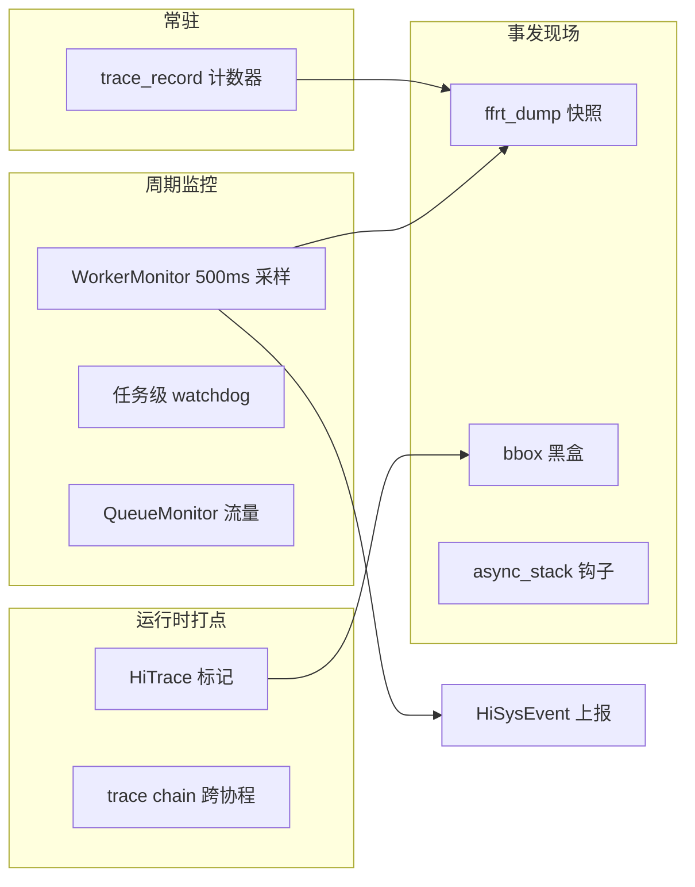

# FFRT 实现细节 · 深挖篇

> 本文是**细节文档**：按模块深挖机制、字段语义、状态机与设计动机。
> 全景认知请先看 **[FFRT源码导读.md](FFRT源码导读.md)**（骨架篇）；查 API 签名与源码锚点请看 **[FFRT参考手册.md](FFRT参考手册.md)**（参考篇）。
> 本文不依赖项目文件：`文件:行号` 仅作可选源码交叉参考，脱离源码可完整阅读。行号基于 2026-10-04 快照。

---

## §1 提交与建图（api + dm）

↩ 对应骨架篇第 2 章主链路 ①~④。参考位置：`src/core/task.cpp`、`src/dm/sdependence_manager.cpp`。

### 1.1 从 API 到依赖管理器

```c
ffrt_task_submit(func, in_deps, out_deps, attr)
    └─ submit_impl(has_handle=false, ...)
         └─ FFRTFacade::GetDependenceManager().onSubmit(...)
```

带 handle 的提交（`ffrt_task_submit_h`）只多一件事：任务引用计数 +1，并把 handle 追加为该任务的**输出签名**（见 §1.3）。延时任务（attr 带 delay）会包一层"先 `sleep_for(delay)` 再执行用户函数"的内层任务，且**不支持依赖描述**（写了会被忽略并记日志）。

### 1.2 onSubmit 的七个步骤

1. **校验输出**：out_deps 里不允许出现任务 handle——handle 是"完成事件"，只能被等待，不能被生产。违反直接报错返回。
2. **定父任务**：取当前执行上下文的任务作父；若提交发生在 FFRT 之外的裸线程，则用该线程 thread_local 的"根任务"（`RootTaskCtxWrapper`）兜底。每个裸线程一个根任务，因此不同线程的提交互不构成父子。
3. **构造任务对象**：placement new（见 §3.2）。
4. **设置属性**：QoS（含 `qos_inherit` 继承父任务；根任务用默认 QoS）、名字（用于 trace）、HiTrace span（若开启链路追踪）、超时看门狗（attr 带 timeout 时注册，见 §8.3）。
5. **依赖去重**：
   - out_deps 先去重；
   - in_deps 去重，且与 out_deps 重复的项跳过（不支持弱签名语义）；
   - handle 型输入依赖转存到 `in_handles_` 向量，同时 handle 引用计数 +1。
6. **建图**：`MapSignature2Deps` 把每个签名换成依赖图节点（§2），输入挂 `AddConsumer`，输出挂 `AddProducer`。
7. **判决就绪**：若任务"提交期依赖计数"（submitDep）非零——还有上游没完成——任务留在图上；否则立刻 `task->Ready()`。

### 1.3 handle 的本质

handle 就是任务对象指针。它的生命周期由删除引用计数（`rc`）管理：

- `ffrt_task_submit_h`：rc+1，且 handle 成为该任务的输出签名（等价于一个只有显式 handle 消费者才知道的私有数据依赖）；
- 依赖它的人（ins 里带 handle）：rc+1；
- 任务 done：正常递减；
- 用户 `ffrt_task_handle_destroy`：显式递减。

### 1.4 就绪与入队

`Ready()` 固定做两件事：按任务 QoS 压入对应调度器运行队列；通知执行单元唤醒 Worker。注意 `notifyWorker_` 开关：某些内部路径（如延时唤醒的内层任务）不需要唤醒动作，避免无谓的唤醒风暴。

### 1.5 等待语义

| API | 等什么 | 判决条件 |
| --- | --- | --- |
| `ffrt_wait()` | 当前任务的**全部子任务** | `childRefCnt == 0` |
| `ffrt_wait_deps(deps)` | **指定数据**就绪 | `dataRefCnt.waitDep == 0` |

wait_deps 的查找有个细节：如果等待的数据正好是当前任务自己的输出，会改挂到**父层级版本**上等待，避免自己等自己的死锁。

---

## §2 数据依赖图（core）

↩ 对应骨架篇主链路 ③⑧。参考位置：`src/core/entity.h/.cpp`、`src/core/version_ctx.h/.cpp`。**这是 FFRT 最核心也最难的一章**。

### 2.1 两个结构

**Entity —— 全局签名表**

```text
Entity（进程级单例）
├── vaMap: unordered_map<void*, VersionCtx*>   // 数据地址 → 最新版本节点
├── versionTrashcan: list<VersionCtx*>          // 待回收的旧版本
└── criticalMutex_: fast_mutex                  // 建图/解图全局临界锁
```

任何 `void*` 地址第一次作为签名出现时，`VA2Ctx` 会创建（或复用）对应的版本节点并登记进 vaMap。**FFRT 不追踪真正的内存读写**——签名只是身份标识，依赖正确性由开发者保证。

**VersionCtx —— 版本节点**

一个"数据地址的某一次写入"就是一个版本：

| 字段 | 语义 |
| --- | --- |
| `signature` | 数据地址 |
| `next` | 非嵌套：下一版本；嵌套：子版本的父版本 |
| `last` | 非嵌套：上一版本；嵌套：父版本的最后一个子版本 |
| `consumers` | 等本版本的消费者集合（RAW） |
| `myProducer` | 本版本的生产者 |
| `nextProducer` | 下一版本的生产者（WAR：须等本版本消费完） |
| `dataWaitTaskByThis` | 显式 `wait_deps` 挂在本数据上的任务 |
| `status` | 数据状态（IDLE 等） |

### 2.2 版本链

非嵌套场景，同一地址的多次写入串成双向链：

```text
v1 <-> v2 <-> v3 <-> data(根节点)
```

RAW：消费者挂到"当前最新版本"的 consumers，等该版本 onProduced。
WAR：新的写者成为 `nextProducer`，必须等当前版本的 consumers 全部 onConsumed 才能开写。

### 2.3 解依赖的两个触发点

**生产完成（任务 done）→ onProduced**：

```text
任务 done
  → 从输出版本的 myProducer 位摘除
  → onProduced: 遍历 consumers，逐个 DecDepRef（依赖计数-1）
  → 某消费者计数归零 → 该消费者 Ready()（回到调度链路）
```

**消费完成 → onConsumed**：

```text
消费者 done
  → 从版本的 consumers 摘除
  → 若 consumers 空且 nextProducer 存在 → 唤醒 nextProducer（WAR 解除）
```

### 2.4 嵌套任务与版本合并

任务 A 输出 x，A 执行中又提交子任务 A1/A2 也输出 x——这就是嵌套写。FFRT 在 A 的版本下创建**子版本链**：

```text
外层:  v1 <-> v2 <-> v3 <-> data
                └─ 子链: v2.1 <-> v2.2（挂在 v2 下）
```

子版本期间，外部消费者挂到子链末端（`last`）；父任务生产完成（onProduced）且末端子版本尚未被消费完时，`MergeChildVersion` 把**最新子版本**折叠进父版本：状态继承；READY 则立即通知消费者；IDLE 则把子版本的消费者与生产者并入父版本，旧节点进版本回收站。折叠逐次进行，外层图结构保持简洁，嵌套只影响局部。

### 2.5 显式 wait_deps 的挂靠

`wait_deps` 的等待任务挂到目标数据的**上一版本**（last 非空且 IDLE 时），通过 `IncWaitDataRef/DecWaitDataRef` 计数控制唤醒；版本推进或生产完成时统一 `NotifyDataWaitTask`。

### 2.6 为什么这么设计

- 地址当签名：开发者零成本表达数据流，不用改造数据结构；
- 版本链：把"多写多读"的偏序关系压缩成链式结构，O(1) 挂靠；
- 全局临界锁只保护图操作本身，任务执行完全无锁——建图/解图都是短临界区。

### 2.7 完整走例：三个任务与两个数据

把前面所有规则串起来。用户代码：

```c
ffrt_task_submit(taskA, NULL, {&a}, NULL);  // A: 写 a
ffrt_task_submit(taskB, {&a},  {&b}, NULL);  // B: 读 a，写 b
ffrt_task_submit(taskC, {&b},  NULL, NULL);  // C: 读 b
```

**submit A**：`vaMap` 里没有 a → `VA2Ctx` 创建 a 的根节点 v0(IDLE)。A 是 a 的 producer：在 v0 下创建子版本 v1(IDLE)，`v1.myProducer = A`，A 的 outs 记 v1。A 无输入依赖，`submitDep=0` → 立即 Ready 入队。

**submit B**：输入签名 a 不匹配 B 父任务（根任务）的任何输出/输入，走 DEFAULT：`AddConsumer` 发现 `v0.last = v1` 非空 → B 挂到**最新子版本 v1** 的 consumers；v1 状态 IDLE → `B.submitDep=1`。输出 b 同 A 的路径：创建 b 的 v0b/v1b，`v1b.myProducer = B`。`submitDep≠0` → **B 不入队，挂在图上**。

**submit C**：同理挂到 b 的 v1b.consumers，`C.submitDep=1`，挂在图上。此时图上：

```text
a: v0(IDLE) ⇄ v1(IDLE, producer=A, consumers={B})
b: v0b(IDLE) ⇄ v1b(IDLE, producer=B, consumers={C})
```

**A 执行完** → `onTaskDone(A)` → 对 A 的输出 v1 调 `onProduced`：consumers 非空 → 状态置 READY，逐个 `DecDepRef` → B 的 submitDep 归零 → **B Ready**，回到调度链路。

**B 执行完** → v1b.onProduced → C 解除 → C Ready。**C 执行完** → v1b.onConsumed：consumers 空 → 状态 CONSUMED、`NotifyNextProducer`（无后继写者）、节点进 versionTrashcan 回收。

**嵌套变体**：若 B 执行中再提交子任务 B1 也写 b——`MapSignature2Deps` 发现 b 命中父任务 B 的输出签名，标记 PARENTOUT，B1 成为 v1b 下的**新子版本** v2b（`v1b.last = v2b`），此后的外部消费者挂 v2b；B 结束时 v1b.onProduced 发现 last 未消费 → `MergeChildVersion` 把 v2b 折叠回 v1b 再通知消费者。

**提交顺序无关**是这套设计的关键性质，两种顺序都正确：

- **先提交 A 再提交 B**（上文）：B 挂到 A 的 v1（IDLE）上等它生产——RAW；
- **先提交 B 再提交 A**：B 的 AddConsumer 发现 `v0.last == nullptr` → 创建一个 **READY** 状态的新子版本并挂上去，READY 不阻塞 → B 立即可跑；随后 A 的 AddProducer 发现 last 非空且状态非 CONSUMED → A 成为 `nextProducer`，**等 B 消费完才能写**——WAR。

也就是说挂靠的是版本节点而非任务完成状态，读写在版本链上的相对位置天然编码了 RAW/WAR，开发者不需要关心提交顺序。

---

## §3 任务对象（tm）

↩ 对应骨架篇主链路 ②⑦。参考位置：`include/tm/task_base.h`、`include/tm/cpu_task.h`、`src/tm/cpu_task.cpp`。

### 3.1 继承体系

```text
TaskBase                 // 状态机虚接口 + gid/qos/rc
├── CoTask               // + func_storage(闭包) + 协程绑定 + 等待队列条目
│   ├── CPUEUTask        // + 父子关系 + 超时 + 嵌套计数
│   │   └── SCPUEUTask   // 最终实现: dataRefCnt / childRefCnt
│   └── QueueTask        // 队列任务（串行/并发语义在队列侧）
├── IOTask               // fd IO 任务（无协程绑定，线程语义）
└── UVTask               // libuv/executor 桥接（无协程绑定，Block 恒为 BLOCK_THREAD）
```

生命周期虚接口：`Prepare / Ready / Pop / Block / Wake / Execute / Finish / Cancel / FreeMem / GetBlockType / SetQos / GetLabel`。基类把"状态怎么变"定死，把"每个状态具体做什么"交给子类。

### 3.2 闭包即任务（placement new）

提交时用户拿到的是闭包头指针 `f`。FFRT 用 `f - offsetof(SCPUEUTask, func_storage)` 反推任务对象首地址，然后 placement new：

```text
┌──────────── SCPUEUTask 对象（一次 slab 分配）────────────┐
│ gid qos rc status ... coRoutine ... func_storage[闭包] │
└──────────────────────────────────────────────────────────┘
                                  ↑ f 指向这里
```

收益：一次分配同时承载元数据和用户闭包；执行时 `(function_header*)func_storage` 直接调 `exec/destroy`；释放时整体归还 slab。代价：宏 `GetCPUTaskByFuncStorageOffset` 做指针回退，闭包与任务强绑定。

### 3.3 引用计数体系

| 计数 | 谁持有 | 归零效果 |
| --- | --- | --- |
| `rc` | 外部 handle / 依赖方 | 触发 `FreeMem` |
| `childRefCnt` | 每个未完成子任务 +1 | 归零可唤醒 `ffrt_wait` 的父任务 |
| `dataRefCnt.submitDep` | 图上未满足的输入依赖 | 归零才允许 Ready |
| `dataRefCnt.waitDep` | wait_deps 挂靠的数据 | 归零唤醒等待者 |

### 3.4 状态机与执行互斥

状态序列：`PENDING → SUBMITTED → READY → EXECUTING → (COROUTINE_BLOCK / THREAD_BLOCK) → FINISH / CANCELED / POPPED`。

状态字段用 relaxed 原子（只服务调试打点）；**真正的执行互斥靠 `skipped` 字段 CAS**（SUBMITTED→EXECUTED），保证取消与执行竞争时任务恰好运行一次。

协程模式下的收尾有个关键设计：任务函数返回后**不立即** `onTaskDone`，而是置 `coRoutine->isTaskDone = true` 并解绑协程，让协程收尾逻辑统一处理。原因：onTaskDone 可能唤醒消费者、消费者立刻复用这块 slab 内存，而当前协程的后续代码还要访问 `task->coRoutine`——提前解依赖就是 use-after-free。

### 3.5 任务族差异

| 类型 | 特点 |
| --- | --- |
| CPUEUTask | 走完整依赖图；支持嵌套、超时、QoS 继承 |
| QueueTask | 闭包同样前置存储；Ready 与普通任务走同一调度路径，顺序/并发约束在队列侧 |
| IOTask | 直接继承 TaskBase（无协程）；绑定 fd，配合 IOPoller |
| UVTask | 直接继承 TaskBase（无协程）；libuv/executor 桥接，调度器侧有专门并发上限与等待队列（§4.3）；用 uvWork 的 wq 链表节点标记出队状态，配合 libuv 的取消语义 |

---

## §4 调度器（sched）

↩ 对应骨架篇主链路 ⑤。参考位置：`include/sched/scheduler.h`、`include/sched/task_scheduler.h`、`src/sched/stask_scheduler.h`。

### 4.1 per-QoS 全隔离

```text
Scheduler（Facade 单例）
├── taskSchedulers[0]  ┐
├── taskSchedulers[1]  │ 每档 QoS:
├── ...                │  独立运行队列 + 独立 Worker 组 + 独立全局锁
└── taskSchedulers[N]  ┘
```

被隔离的四样东西：**运行队列、Worker 线程池、全局调度锁、监控计数**。好处：低 QoS 任务再怎么洪泛，也不会拖慢高 QoS 的入队与取队。

### 4.2 队列结构（当前版本）

默认实现 `STaskScheduler` 是**单一 FIFO 全局队列**（`FIFOQueue`：侵入式链表 + 原子计数），没有 Worker 本地队列，也没有偷取：

- `PushTask` 在该 QoS 的全局锁（`g_schedMtx[qos]`）下入队，返回 `taskCount == 1` 即 "rising edge"——队列从空变非空，调用方据此决定是否唤醒 Worker；
- `PopTask` 同一把锁下 FIFO 出队；UV 任务出队时先过取消集合检查；
- 队列积压超过 1000 时，每 500 个任务发一次 sysevent 告警；
- `stealingInProgress` 字段在当前代码里只有读取接口（`IsStealerActive`），**没有写入点**——属于预留的偷取抑制接口，不应当作现行机制。

### 4.3 UV 任务并发控制

UVTask（外部事件桥接）的**完整回流**（参考位置：`src/core/task.cpp:630-660`、`src/tm/uv_task.cpp`）：

```text
宿主启动: ffrt_executor_task_register_func(func, ffrt_uv_task)
           → FuncManager 建立 类型→回调 的静态映射（io/uv 初始为 nullptr）
事件到达: ffrt_executor_task_submit(uvWork, attr)     # 不支持 delay
           → OnSubmitUV: UVTask 工厂分配 + Ready()
Ready():   先试 PushUVTaskToWaitingQueue
             ├─ UV 并发已达上限 → 进等待队列，返回
             └─ 未超限 → 正常 PushTask + NotifyTask
Execute(): CheckUVTaskConcurrency 二次校验（执行时刻可能已超）
             ├─ 超限 → 返回，任务留在等待队列
             └─ 通过 → FuncManager::getFunc(ffrt_uv_task) 取宿主回调
批量收割:  while 循环 { func(uvWork, qos); DecDeleteRef;
                        task = PickWaitingUVTask(); }
           —— 同一 Worker 连续处理等待队列里的任务，摊平唤醒开销
取消:      ffrt_executor_task_cancel → Scheduler::CancelUVWork → cancelSet
           出队时发现自己在集合里 → 直接释放
```

与 libuv 的对接细节：`ffrt_executor_task_t` 的 `wq[2]` 字段是链表节点，UVTask 构造时把 uvWork 的 wq 入队——利用 libuv 判断"任务是否已出队"的 `uv__queue_empty` 语义来配合其取消逻辑。这套并发控制独立于普通任务的调度。

### 4.4 帧调度与截止时间（deadline / interval）

inner_api 的 `ffrt_interval_*` 系列服务图形栈的"帧截止时间"场景（参考位置：`src/sched/deadline.cpp:57-146`、`src/sched/interval.h`）。核心抽象是 `Interval`（Begin / Update / End / CheckPoint / Join / Leave 六个动作），两个实现：

| 实现 | 机制 | 用途 |
| --- | --- | --- |
| `DefaultInterval` | `KernelLoadTracking`（内核负载跟踪）+ `IntervalLoadPredictor`（总量/关键路径两级负载预测）+ `PerfCtrl`（封装 RTG 线程组的 Begin/End/Join/Leave 与负载窗口） | 一般截止时间场景：按预测负载调 RTG |
| `FrameInterval` | 挂 WorkGroup，Begin/End 时向同 QoS 的 interval 组广播状态 | 帧渲染：一帧一个 interval，组内协同 |

`Deadline` 类负责相对截止时间 → 绝对截止时间换算与剩余时间查询；`PerfCtrl` 以 2^10 为容量刻度，按预测利用率决定 RTG 频率抬升时机。另有任务级 `TaskLoadTracking`（`src/sched/sched_deadline.h`）：协程切入/切出时累计任务负载，喂给预测器。这些机制只经 inner_api 暴露给系统图形组件，作用在**线程组（RTG）层**而非任务队列层，普通业务任务感知不到。

---

## §5 执行单元与协程（eu）

↩ 对应骨架篇主链路 ⑥⑦⑨。参考位置：`src/eu/cpu_worker.cpp`、`include/eu/execute_unit.h`、`src/eu/co2_context.c`。

### 5.1 Worker 组结构

每个 QoS 一个 `CPUWorkerGroup`：

| 字段 | 作用 |
| --- | --- |
| `tg` (ThreadGroup) | RTG 内核线程组，调度聚合 |
| `threads` | Worker 线程表 |
| `hardLimit / maxConcurrency` | 数量上限 / 并发上限 |
| `executingNum / sleepingNum / deepSleepingWorkerNum` | 伸缩决策三计数 |
| `fastWakeEnable / pendingWakeCnt / pendingTaskCnt` | 快唤醒通道 |
| `workerShareConfig` | 跨 QoS 共享 Worker 的配置（方向由配置决定） |

### 5.2 唤醒路径

`NotifyTask` 按事件类型（TASK_PICKED / ADDED / ESCAPED / ADDED_RTQ）决定动作：

- 快唤醒开启且有待唤醒 Worker：futex 直达第一个睡眠者（绕过条件变量）；
- 否则走条件变量广播；
- 没有可用 Worker 且未超上限：新建。

### 5.3 Worker 主循环与伸缩

```text
loop:
    task = scheduler.PopTask(qos)        // 从该 QoS 的全局 FIFO 队列取任务
    if task: ExecuteTask(task)           // 协程中运行
    else: 睡眠（浅睡 → 深睡逐级降级）
```

睡眠分浅睡与深睡（`sleepingNum` / `deepSleepingWorkerNum`），深睡线程可被事件直接唤醒（irqEnable）。**逃逸（escape）**是"有任务却无运行中 Worker"时的补偿扩容：`SubmitEscape` 按延迟触发 `ExecuteEscape`，检查间隔随 Worker 总数分三档限流（<128 → 10ms、<256 → 100ms、≥256 → 1000ms），Worker 越多检查越稀疏，防止无限膨胀；扩容同时以最高 1 次/秒的频率上报 escape 事件。**worker share** 按配置允许一个 QoS 组的 Worker 兼职执行其他 QoS 的任务（方向由 `workerShareConfig` 决定，优先级切换分支尚未实现）。

### 5.4 协程闭环

底座：`co2_context.c` 的上下文切换汇编；`CoRoutineFactory` 池化协程对象；`CoStackAttr` 管理栈（默认 1MB）。

阻塞原语只有一对：

```text
CoWait(pred):
    保存 pred → 协程切出到 Worker 调度上下文
    Worker 立即评估 pred:
        true  → 真正阻塞：任务所有权交给阻塞原语（cv/mutex/epoll）
        false → 条件已满足：直接切回协程继续执行（快路径，不过调度器）
唤醒 CoWake:
    普通任务 → task->Ready() 重新入队
    队列任务 → 转回 QueueHandler 派发
```

判定协程还是线程模式：`非根任务 && 协程开启 && legacyCount<=0`。TSAN 构建会把协程整体关掉（`FFRT_CLOSE_COROUTINE_MODE`），退化为线程模式保证检测可信。

### 5.5 IOPoller：fd 事件线程

`IOPoller`（`src/eu/io_poller.h`，Facade 单例）封装 epoll + eventfd，专职处理 fd 事件，三态生命周期：`HANDLING`（执行回调，同步回调可能阻塞该线程）→ `POLLING`（epoll_wait 睡眠等事件）→ `EXITED`（无事件时**线程自毁**，下次注册再重建）。

主路径：任务 `sync_io(fd)` / loop 等事件时注册 fd → 让出协程 → 事件到达 → 事件先缓存在 poller 侧 → 唤醒任务。任务释放时 `ClearCachedEvents` 统一清理，防悬空回调。配套能力：`WakeTimeoutTask`（等待超时唤醒）、`MonitTimeOut`（被 WorkerMonitor 的 500ms 采样调用，检查 poller 回调是否超时阻塞，见 §8.4）、`PollerRegisterTimer`（按 QoS 注册 poller 侧定时器）。

### 5.6 QoS / RTG 内核接口

`qos_interface.cpp` 封装 OHOS QoS 系统调用；`rtg_ioctl.cpp` 通过 ioctl 管理 RTG 线程组（宏 `QOS_WORKER_FRAME_RTG`）。非 OHOS 平台退化到仓库内 staging QoS 实现。

---

## §6 同步原语（sync）

↩ 对应骨架篇主链路 ⑨。参考位置：`src/sync/mutex.cpp`、`src/sync/sleep.cpp`、`src/sync/wait_queue.cpp`。

### 6.1 统一模式

所有原语收敛到同一骨架：**拿不到 → CoWait 让出 → 可用 → WaitQueue 唤醒 → 重新 Ready**。

`WaitQueue` 是共享底座：锁的等待者、cv 的等待者、sleep 的定时唤醒全部挂同类结构，唤醒按 FIFO。

### 6.2 sleep 的实现

```text
sleep_for(dur):
  1. 到期时刻注册给 TimerManager / DelayedWorker
  2. CoWait: 注册"到期回调唤醒本协程" → 让出
  3. Worker 立刻执行其他任务（协程价值所在）
  4. 到期 → WaitQueue 唤醒 → 任务重新 Ready
```

两个时间设施的分工：

- **DelayedWorker**（`include/sync/delayed_worker.h`）：专职延时线程，内部是 `multimap<TimePoint, DelayedWork>` 优先队列 + timerfd/eventfd 唤醒。`dispatch` 注册定时唤醒（watchdog、WorkerMonitor 周期任务、sleep 都走它）；`SubmitAsyncTask` 把回调包装成**真正的 FFRT 任务**（默认 background QoS，支持依赖）投回调度器——它既是"闹钟"也是"延时任务提交器"。
- **TimerManager**（`src/sync/timer_manager.h`，Facade 单例）：面向 `ffrt_timer_*` API。`timerMap` 管理定时器句柄，状态机 NOT_EXECUTED → EXECUTING → EXECUTED（repeat 则循环）；关键设计是**按 QoS 维护工作队列依赖（workQueDeps）**，保证同 QoS 定时回调**按注册顺序执行**；到期时把用户回调作为队列任务投递，并携带 trace chain span。

### 6.3 锁族

| 原语 | 变体 | 说明 |
| --- | --- | --- |
| mutex | normal / recursive | `lock_wait/unlock_wake` 是内部拆分接口 |
| condition_variable | — | 与 mutex 配合 |
| shared_mutex | — | 读写锁 |
| thread | inner_api | ffrt 线程封装 |
| record_mutex / record_cv | — | 记录锁持有者（任务 gid / 线程 tid）与持有时长，超 30s 判定超时，供死锁检测与上报 |

---

## §7 队列（queue）

↩ 对应骨架篇 Queue-Enabled 特性。参考位置：`src/queue/queue_api.cpp`、`src/queue/queue_handler.h`。

### 7.1 结构与策略

`ffrt_queue_create` → `QueueHandler`（名字、QoS、并发度等属性 + worker 管理）；内部按类型选策略：

- **串行队列**：同一时刻只有一个任务在执行，FIFO；
- **并发队列**：多个任务并行，可设整体并发上限。

### 7.2 与调度的关系

`QueueTask::Ready()` 与普通任务**走完全相同的调度路径**（Scheduler::PushTask + NotifyTask）。串行/并发语义不靠独立调度器，而是靠**队列侧的派发驱动与并发计数**：QueueHandler 用驱动任务从队列拉取（`PickUpTask`/`Pull`），串行队列一次只派发一个，并发队列用 `concurrency_` 计数对照 `maxConcurrency_` 控制同时在外的任务数（`WaitAll` 等计数归零）——这是"复用主链路，策略外置"的设计。

### 7.3 监控与适配

- `QueueMonitor`（Facade 单例）：队列超时监控（见 §8.7 的 Serial_Queue_Timeout）；
- `TrafficRecord`（每队列一个）：流量过载检测。两个累计计数 `submitCnt_`（subcnt，累计提交）/ `doneCnt_`（doncnt，累计完成）按默认 6s 窗口求增量得 in/out；当"进大于出 + 积压超阈值 + 队列现存 >15"时打过载日志并存入环形记录（128 条，供 dump/box 输出），严重时按 ≥60s 限频上报 sysevent。计数超约 1677 万时双双同减防溢出（差值即积压，不受影响）。宏 `FFRT_ENABLE_TRAFFIC_MONITOR` + Beta 双重门控；
- `EventHandlerAdapterQueue` / `EventHandlerInteractiveQueue`：把 FFRT 队列适配成系统 EventHandler 队列，服务存量系统集成与交互场景。

### 7.4 队列问题排查（subcnt / doncnt / 过载诊断）

**过载日志格式**：`[队列名]overload over[观测ms], in[本窗口提交], out[本窗口完成], subcnt[累计提交], doncnt[累计完成]`（doncnt 是源码原始拼写，非笔误）。

| 字段 | 来源 | 含义 |
| --- | --- | --- |
| in / out | 计数器的窗口差值 | 默认 6s 观测窗口的增量流量 |
| subcnt / doncnt | `submitCnt_` / `doneCnt_` 当前值 | 队列创建以来的**累计值** |
| subcnt − doncnt | — | **当前在途任务数**（排队 + 待执行 + 执行中 + 阻塞中）；防溢出同减不影响差值，数值可信 |

**过载诊断三分法**（结合 in/out 趋势与 dump 状态分布）：

| 画像 | 特征 | 定性 | 处置方向 |
| --- | --- | --- | --- |
| 生产过载 | in > out 且差值持续扩大；队列现存数接近差值 | 提交速率超消费速率 | 业务限流 / 提高消费并发 / 拆队列 |
| 消费卡死 | in、out 趋近 0，差值停滞；dump 中大量 enqueued | 队头阻塞（串行队列典型：1 个 blocked + 全部排队） | 看 dump 暂停协程回溯，直接定位卡点 |
| 合法深流水线 | 差值稳定、in≈out、无持续告警 | 大量延时任务或稳态深队列 | 评估内存后可接受 |

**排查路径**：过载日志看 in/out 趋势（扩大 → 画像 1；停滞 → 画像 2；稳定 → 画像 3）→ `ffrt_dump(DUMP_INFO_ALL)` 按状态分组（几乎全 enqueued 说明没消费；大量 executing/blocked 说明卡在同步原语）→ dump 的 TrafficRecord 历史（128 条）看积压怎么涨起来 → 串行队列再查 Serial_Queue_Timeout 事件。

**过载对执行的影响，分开看两件事**：

- **排队延迟是必然代价**：第 N 个任务等待 ≈ N × 平均单任务耗时，这是队列语义本身，不是机制故障；
- **执行吞吐的次生影响有限**：队列锁竞争（pull 有批量摊销）、过载日志开销（阈值 16→128 递增打点）、slab 内存与缓存局部性、调度超时注册开销；
- **队列外任务基本不受冲击**：积压躺在队列自己的 `whenMap_` 里，只有达到并发上限的任务才进调度器；但同 QoS 的普通任务会和已派发的队列任务竞争全局队列；
- **警惕因果倒置**：过载常常是执行卡顿的**结果**而非原因（队头卡死 → 积压暴涨）——先分诊再下结论。

**两个易踩的坑**：并发队列不设 `max_concurrency` 时**默认并发度为 1**（按串行跑）；在途任务连同闭包都活在 slab 里（每个几百字节起），长期维持大水位要评估内存压力。

---

## §8 维测（dfx）

↩ 全模块共用。参考位置：`src/dfx/`、`src/util/worker_monitor.cpp`、`tools/ffrt_trace_process/`。

**为什么维测对 FFRT 格外重要**：任务被协程打散到各个 Worker 线程后，系统级工具看到的是"线程在跑一段不知道谁的代码"；任务对象在 slab 里循环复用，崩溃时的内存快照难以对应业务；一个任务卡死在 mutex 上，普通线程 dump 只能看到 Worker 在睡觉。dfx 子系统就是为了补上这层"任务视角"的可观测性。

维测按开销从低到高分四层：**常驻计数（几乎零开销）→ HiTrace 打点（tag 开启才有开销）→ 周期监控（500ms 采样）→ 事发现场（dump/bbox）**。



### 8.1 HiTrace 全生命周期打点

通过 `TraceAdapter` 动态加载 `libhitrace_meter.so`（dlopen/dlsym，加载失败自动退化为 stub），统一使用 FFRT 专属 tag（`HITRACE_TAG_FFRT = 1<<13`）。所有标记先查 `IsTagEnabled`（unlikely 分支），未开启时零开销。

标记分两类，命名有固定约定，是 trace 解析工具的协议：

| 标记 | 类型 | 名称格式 | 含义 |
| --- | --- | --- | --- |
| `FFRT_SUBMIT_MARKER` | 同步 | `P %gid` | 任务提交 |
| `FFRT_TASK_BEGIN(tag, gid)` | 同步 | `FFRT%s\|%gid` | 任务开始执行 |
| `FFRT_BLOCK_TRACER(gid, tag)` | 同步 | `FFBK%s\|gid` | 阻塞原因标签：dep（依赖未满足）/ chd（等子任务）/ dat（等数据）/ mtx（互斥锁）/ smx（读写锁）/ cnd（条件变量）/ cnt（计数）/ fd（等 fd 事件）/ slp（睡眠）/ yld（主动让出） |
| `FFRT_WAKE_TRACER(gid)` | 同步 | `FFWK\|gid` | 被唤醒 |
| `FFRT_EXECUTOR_TASK_BEGIN` | 同步 | `FFRTex_task\|gid` | 外部 executor 任务 |
| `FFRT_SERIAL_QUEUE_TASK_SUBMIT_MARKER` | 同步 | `P[sq_qid]\|gid` | 串行队列提交 |
| `FFRT_READY_MARKER` | 异步 | `R` | 就绪（结束 submit→ready 异步段） |
| `FFRT_BLOCK_MARKER` | 异步 | `B` | 阻塞（结束 running→block 异步段） |
| `FFRT_TASKDONE_MARKER` | 异步 | `F` | 完成 |

异步标记按 gid 配对：submit 开启异步段，R/B/F 分别关闭对应阶段——在 trace 时间轴上拼出任务完整生命周期，即使它跨越多个 Worker 线程。

**trace chain（跨协程链路）**：提交时若当前线程有有效 HiTraceChain id，则 `CreateSpan` 存进 `task->traceId_`；协程切入时 restore、切出时 save+clear（`src/eu/co_routine.cpp` 的 FFRT_TASK_BEGIN/END 路径）。业务发起的调用链因此穿透任务边界不中断。

### 8.2 trace_record：分级统计与明细窗口

`FFRTTraceRecord`（`include/dfx/trace_record/ffrt_trace_record.h`）按编译期 `FFRT_TRACE_RECORD_LEVEL` 分级：

| 级别 | 记录内容 |
| --- | --- |
| L1 | 仅记录"FFRT 被使用过"标志 |
| L2 | 计数器：submit / enqueue / run / done / cancel / coSwitch，按**任务类型 × QoS** 二维展开；另有 `CoCounterInSwitch`（当前让出中的协程数，瞬时值） |
| L3 | 追加时间统计：waitTime（等调度）与 runDuration（执行）的累计值和最大值；每 QoS 历史最大 Worker 数 |

计数器全部 cache-line 对齐 + relaxed 原子，热路径无锁。派生不变量用于自检：**RunCounter == CoSwitchCounter + FinishCounter**（跑过的任务要么让出中要么已结束），bbox 会显式校验并打印该等式是否成立。

明细窗口：`ffrt_dump(DUMP_START_STAT, buf, len)` 把外部缓冲注册为环形缓冲，此后每个完成的任务写入一条 `ffrt_stat{taskName, funcPtr, startTime, endTime}`；`DUMP_STOP_STAT` 停止并归还。相当于给一段业务做"任务级 profiler"。

### 8.3 任务级 watchdog

attr 带 timeout 的任务走轻量看门狗（`src/dfx/watchdog/watchdog_util.cpp`）：

1. onSubmit：gid 加入 `taskStatusSet`，并向 DelayedWorker 注册 `now + timeout + delay` 的定时回调（`SendTimeoutWatchdog` @ :48）；
2. Execute 入口：gid 移除（正常路径）；
3. 定时触发：若 gid 仍在集合 → 任务未按时执行 → `RunTimeOutCallback`（@ :86）：打 ERROR 日志；若用户配了 `timeoutCb_`，把它作为异步任务投给 DelayedWorker 执行（注意：**在 DelayedWorker 线程上跑，不过调度器**）。

关键语义：watchdog **只检测不取消**——超时后任务继续执行，回调用于业务侧降级/记录。队列任务另有队列级超时（见 §7.3 与 8.7 的 Serial_Queue_Timeout 事件）。

### 8.4 WorkerMonitor：周期监控（生产环境主力）

`src/util/worker_monitor.cpp`，Facade 单例，由首次任务提交激活（Beta 版本 + 白名单门控），内部跑三个 DelayedWorker 周期任务：

| 周期任务 | 周期 | 职责 |
| --- | --- | --- |
| 采样 | 500ms | `CheckWorkerStatus`（@ :152） |
| 任务监控 | 自适应（默认 30s 阈值） | `CheckTaskStatus`（@ :199） |
| 资源回收 | 60s | 协程内存收缩 + Worker 存活状态日志 |

**Worker 占用检测（CheckWorkerStatus）**：每 500ms 扫全部 QoS 的 Worker 组；发现**同一个任务连续占用 Worker**（每秒采样计一次）时，按阶梯 `{1, 5, 10, 30, 60, 600, 1800}s` 逐级记录——第 1 秒记录 8 帧短栈，之后越久记录越稀；每级触发时在后台任务里打该 Worker tid 的**符号+回溯**（`RecordSymbolAndBacktrace` @ :360）。占用满 60s → 上报 `CONGESTION/Task_Sch_Timeout` FAULT 事件（每进程仅一次，带栈、tid、qos、uid）。

**IPC 卡死检测**：回溯里出现 `libipc_common` 且占用 ≥600s 时，读取 `/proc/transaction_proc`，用正则匹配该 tid 的挂起 IPC 事务并打印（`RecordIpcInfo` @ :408）——直指"FFRT 任务卡在跨进程调用"这一最常见生产事故。

**任务状态超时检测（CheckTaskStatus）**：扫描 slab 里未释放的任务，凡是**状态长时间不变**（`statusTime + timeoutCnt×阈值` 早于现在）就记录一条 `label|gid|qos|状态|时间|前状态|倍数|次数`（`RecordTimeoutTask` @ :270，频控：前 50 次每 1 次记、之后每 100 次记）；主动延时任务与 `monitorTimeout_=false` 的任务跳过。下一次检查时间取**所有任务中最早的状态时间**（自适应，不用固定轮询）。最近 64 条进环形记录，供 dump/bbox 输出。

**Worker 存活日志**：周期输出各 QoS 新建/退出的 Worker tid 列表，以及队列非空时的 `R(执行中)/S(睡眠)/M(最大并发)/H(硬上限)` 四计数。

### 8.5 dump：运行时快照

`ffrt_dump(cmd, buf, len)`（`src/dfx/dump/dump.cpp:157`）四条命令：

| 命令 | 内容 |
| --- | --- |
| `DUMP_INFO_ALL` | 全量快照（见下） |
| `DUMP_TASK_STATISTIC_INFO` | L2 计数器汇总（按 normal/queue/UV 任务分类输出） |
| `DUMP_START_STAT` / `DUMP_STOP_STAT` | 开/关任务明细环形记录（§8.2） |

全量快照内容（`dump_info_all` @ :128）：时间与 pid 前言 → 任务计数器 → 关键状态（其他模块经 `SetFuncSaveKeyStatus` 注册的回调）→ 每 QoS Worker 数量/tid/正在跑的任务及类型 → **普通任务普查**（slab 未释放任务按 pending/ready/popped/executing/blocked 分组）→ **队列任务普查**（按 handler 分组、按 uptime 排序、按状态分组）→ 超时任务记录 → 队列流量。

**DumpTask：暂停协程的栈回溯**（@ :62）——dfx 最精巧的一段：从协程保存的寄存器上下文重建 `ucontext`（aarch64 用 `ctx.storage[10/11/13]` 还原 fp/pc/sp；x86/arm 各有对应），结合协程栈上下界，用 OHOS Unwinder 走一遍**已挂起协程**的栈。效果：任务卡在 mutex/cv/sleep 时，dump 能直接打出它卡在哪一行，而不是只看到 Worker 线程空闲。普查时对每个 COROUTINE_BLOCK 状态的任务都做一次。

另有全局任务超时配置（`ffrt_task_timeout_set_threshold`，默认 30s、下限 1s）与全局超时回调（`ffrt_task_timeout_set_cb`，回调自动包一层 trace chain restore，让超时事件带上下文）。

### 8.6 bbox：崩溃黑盒

`src/dfx/bbox/bbox.cpp`。库加载时注册信号处理：SIGABRT/BUS/FPE/ILL/STKFLT/SYS/TRAP/INT/KILL。

触发流程（`SignalHandler` @ :471）：

1. CAS 保证**只保存一次**；FFRT 未使用过则直接放行；
2. 初始化 FaultLogger fd；
3. **clone 子进程**在隔离环境写黑盒（`SaveTheBbox` @ :397），父进程最多等 2s，超时杀掉（CameraDaemon 特例双等待）；
4. 写完注销自己的 handler，把信号**重发给默认处理**——崩溃流程照常走，FFRT 只是蹭了一段现场。

黑盒内容：当前信号/pid/tid/当前任务（id/qos/名/状态）→ 任务计数器 + 不变量校验 → Worker 状态 → 关键状态回调 → 普通任务普查（含暂停协程栈回溯）→ 队列任务普查 → 超时记录 → 队列流量。

**slab 冻结**：任务 `FreeMem` 前调 `BboxCheckAndFreeze`——黑盒正在写时自旋等待，防止任务内存被回收复用导致快照读到张冠李戴的数据。普查本身依赖 slab 的 `GetUnfreedMem` 能力：分配器天然知道哪些任务对象还活着，这是"任务普查"的数据底座。

### 8.7 sysevent：事件与限频

`src/dfx/sysevent/sysevent.cpp`（宏 `FFRT_SEND_EVENT`），全部 Beta 版本门控（`IsBeta`：读系统参数 `const.logsystem.versiontype` 是否 commercial）：

| 事件 | 场景 | 限频 |
| --- | --- | --- |
| `TASK_TIMEOUT` | 长任务（>1s 状态未变，`TaskBlockInfoReport`） | 首次 5min 预热后，每 30min 一次 |
| `CONGESTION` / Task_Sch_Timeout | Worker 被单任务占用 60s（§8.4） | 每进程一次，带栈 |
| `CONGESTION` / Serial_Queue_Timeout | 串行队列任务执行超时（§7.3） | 每进程一次，带栈 |
| `CONGESTION` / Trigger_Escape | 逃逸扩容触发（§5.3） | 每进程一次 |
| `TASK_TIMEOUT` / QUEUE_TASK_OVERLOAD | 队列任务流量过载（`TrafficOverloadReport` @ `src/queue/traffic_record.cpp`） | 距上次上报 ≥60s |

注：`hisysevent.yaml` 里还定义了 `QUEUE_OVERFLOW`，但当前源码没有上报该事件名的路径，属预留定义。

### 8.8 日志体系

`include/dfx/log/ffrt_log_api.h`：hilog 后端（domain 0xD001719，tag "ffrt"），编译期分级 `FFRT_LOG_LEVEL`（ERROR=0 … DEBUG=3）。OHOS 标准系统下所有日志经 Beta 版本门控，DEBUG 级还叠加白名单；格式串自动做 `{public}` 隐私标注；支持格式串字典压缩（HILOG_FMTID）。三个衍生宏：`FFRT_BBOX_LOG`（日志 + faultlogger 双写）、`FFRT_SYSEVENT_LOG*`（日志 + 事件上报）、工程调试版的 `FFRT_COND_TERMINATE`（致命条件直接 terminate 并携带 fatal message）。

**日志与观测通道总览**（排查时先选对通道）：

| 通道 | 内容 | 门控 |
| --- | --- | --- |
| hilog（tag `ffrt` / 0xD001719） | FFRT 全部运行日志 | Beta + `FFRT_LOG_LEVEL` |
| HiTrace（tag bit 13） | 任务生命周期标记 P/R/B/F | tag 开启才有开销 |
| trace_record | 进程内计数器与明细环形缓冲 | `FFRT_TRACE_RECORD_LEVEL` |
| sysevent | 过载 / 超时 / 逃逸事件 | `FFRT_SEND_EVENT` + Beta |
| stdout | 非 OHOS Linux 构建的日志后端 | — |
| kmsg | **正常情况下无任何 FFRT 输出** | — |

**与内核日志（kmsg）的关系**：任务提交、futex 唤醒、Worker 创建（clone）在内核侧正常均静默；QoS（`/proc/thread-self/sched_qos_ctrl`）、RTG（`/proc/self/ffrt`）等 ioctl 失败时也是 FFRT 在 hilog 报错而非 kmsg。kmsg 出现 FFRT 相关内容的场景只有异常：内核 QoS/RTG 驱动自身报错、进程崩溃（bbox 重发信号后段错误）、OOM、hung task。**kmsg 静默是正常态，kmsg 里有 FFRT 内容反而说明出事了。**

### 8.9 async_stack：跨协程调用栈钩子

FFRT 自己不实现异步栈采集，只提供**注册钩子**：外部采集器（如 DFX 子系统）经 `FFRTSetAsyncStackFunc` 注册 collect/set/release 三个回调。采集时机：submit 时 `FFRTCollectAsyncStack(POOL/QUEUE)` 得到 stackId 存进任务；协程切入时 `FFRTSetStackId`（`co_routine.cpp:464`）；FreeMem 时 release。配合 §8.5 的暂停协程回溯，实现"任务切了多少次协程，调用链都能拼回来"。

### 8.10 perf 与 trace 工具链

- **perf**（默认关闭，`FFRT_PERF_ENABLE`）：`PerfTraceScoped` 基于 perf_event_open 按模块（EU/SCHED/DM/QUEUE/SYNC/CUSTOM）测热路径 cycles/instructions；另有 `FFRT_TRACE_COUNT` 瞬时值（Worker 唤醒数、每 QoS 任务数）。
- **trace 工具**（`tools/ffrt_trace_process/`）：`ffrt_trace_recover.py` 把被打散到各 Worker 的 trace **复原成逻辑任务视角**；`ffrt_trace_process.py` 输出任务生命周期（task_info.csv）、线程运行（thread-name.txt）、进程汇总（summary.txt）及带状态计数的 perfetto 增强版 trace；另有 GUI（`ffrt_trace_process_gui.pyw`）。工具依赖 §8.1 的标记命名协议。

---

## §9 初始化与 Facade（util）

↩ 对应骨架篇第 6 章"接口 + 工厂注册"。参考位置：`src/util/init.cpp`、`src/util/ffrt_facade.h`。

### 9.1 装配顺序

`libffrt` 加载时（constructor 属性）执行 `ffrt_init`：

```text
1. ExecuteCtx::CtxEnvCreate()        // 执行上下文环境
2. DelayedWorker::ThreadEnvCreate()  // 延时线程环境
3. CoEnvCreate()                     // 协程环境
4. RegistCommonTaskFactory()         // Queue/IO/UV 任务工厂
5. RegisterTaskFactoryCallbacks<CPUEUTask, SCPUEUTask>()
6. SchedulerFactory::RegistCb(→ new STaskScheduler)
7. DependenceManager::RegistInsCb(→ SDependenceManager)
8. ExecuteUnit::RegistInsCb(→ SExecuteUnit)
9. SetFuncQosMap / SetFuncQosMax     // QoS 映射
```

顺序有讲究：先备好三类线程环境，再注册对象工厂，最后注册子系统实现——保证任何后续懒加载的单例拿到的都是完整装配。

### 9.2 Facade 快路径

```text
FFRTFacade::GetScheduler():
    if gScheduler != nullptr: return *gScheduler   // 热路径：一次全局指针读
    else: LazyInstance()                            // 冷路径：首次懒加载全部单例
```

每个子系统一个全局裸指针，配合单例列表宏（SINGLETON_LIST）生成——依赖管理、IO poller、定时器、调度器、Worker 监控、执行单元、延时线程、协程栈、队列监控、trace chain 全在这张名单里。

### 9.3 基础设施

- **slab 对象池**：任务/协程对象的分配底座，大幅摊薄分配成本；
- **graph_check**：用户依赖图合法性检查（环检测）；
- **worker_monitor**：Worker 存活监控；
- **white_list / capability**：权限与白名单管理。

### 9.4 退出与析构路径（teardown）

FFRT 没有显式的 `ffrt_deinit` API——退出完全依赖 **C++ 静态对象的逆序析构**，构造顺序就是精心设计的析构倒排（参考位置：`src/util/ffrt_facade.cpp` FFRTFacade 构造函数注释、`src/eu/sexecute_unit.cpp:79-121`、`src/sync/delayed_worker.cpp:235-255`）。

**触发链**：进程退出 → `ProcessExitManager`（Facade 中最后构造的静态对象，因此最先析构）→ `LockExitMtx()` 持住进程级退出锁直到析构完成（阻止退出途中新建线程）+ `SetExitFlag()`（全局退出标志，消费点是 bbox 的 `FFRTIsWork` 与串行/并发队列的等待路径；Worker 的退出走各 WorkerGroup 的 `tearDown` 标志）。

**SExecuteUnit 析构**：`tearDown=true` → 逐 QoS `SetTearDown`（唤醒全部睡眠 Worker，Worker 空闲动作发现 tearDown 直接 RETIRE 退出）→ 轮询等待各 QoS 的 threads 表清空（限时重试，超时 sysevent 报错）→ 最后才 `DelayedWorker::Terminate()`——注释明说：DelayedWorker 可能还在调 `SExecuteUnit::WakeupWorkers`，必须保证 EU 活到那之后。

**DelayedWorker 终止与析构**：`Terminate` 置 `toExit` 并把 timerfd 超时归零（立即唤醒 epoll_wait）后 join 线程；析构再置 DelayedWorkerExitFlag 并**自旋等待 asyncTaskCnt_ 归零**——它提交过的异步任务（本身是 FFRT 任务）必须全部完成。

**构造顺序与防 UAF 推理**（源码注释原文的提炼）：

| 构造顺序（先→后） | 析构顺序（先→后） | 防什么 |
| --- | --- | --- |
| FuncManager → SExecuteUnit | SExecuteUnit → FuncManager | Worker 析构时仍要查 func_map |
| DependenceManager → DelayedWorker | DelayedWorker → DependenceManager | DW 的异步任务会调 DM::onTaskDone |
 | DelayedWorker → TimerManager | TimerManager → DelayedWorker | 定时器到期仍要 DW 投递 |
| ExecuteUnit → IOPoller | IOPoller → ExecuteUnit | poller 不能在 EU 销毁期间还去唤醒 Worker |

另外 bbox 的信号处理注销也是 destructor（`BBoxDeInit`）；`ffrt_child_init` 的存在说明 fork/clone 后需显式重建这套静态环境。

---

## §10 宏开关与平台差异

| 宏 | 作用 | 备注 |
| --- | --- | --- |
| `USE_OHOS_QOS` | 系统级 QoS 接口 | 关闭则用 staging 实现 |
| `QOS_WORKER_FRAME_RTG` | RTG 线程组 | 帧调度相关 |
| `FFRT_CLOSE_COROUTINE_MODE` | 关闭协程 | TSAN 构建自动启用 |
| `FFRT_OH_TRACE_ENABLE` | HiTrace | |
| `FFRT_TRACE_RECORD_LEVEL` | 事件记录级别 | |
| `FFRT_ASYNC_STACKTRACE` | 异步调用栈 | |
| `FFRT_BBOX_ENABLE` | 黑盒冻结 | |
| `FFRT_TASK_LOCAL_ENABLE` | 任务级 thread-local | |
| `FFRT_WORKERS_DYNAMIC_SCALING` | Worker 动态伸缩 | 配合 blockaware |
| `FFRT_SEND_EVENT` | Beta 版本事件 | |

构建：OHOS 用 GN（`BUILD.gn`），通用平台用 CMake（`CMakeLists.txt`），导出符号由 `libffrt.map` 约束。

---

## §11 源码交叉参考（可选）

仅有源码时用于对照，不影响本文阅读；行号基于 2026-10-04 快照，以函数/类名检索为准。

| 主题 | 参考位置 |
| --- | --- |
| 装配入口 | `src/util/init.cpp:52` |
| 单例门面 | `src/util/ffrt_facade.h` |
| 提交主流程 | `src/core/task.cpp:76` → `src/dm/sdependence_manager.cpp:68` |
| 依赖图 | `src/core/entity.h`、`src/core/version_ctx.h/.cpp` |
| 任务对象 | `include/tm/task_base.h`、`src/tm/cpu_task.cpp:49`（Ready） |
| Worker 循环 | `src/eu/cpu_worker.cpp:239` |
| per-QoS 调度 | `include/sched/scheduler.h`、`src/sched/stask_scheduler.h` |
| 协程底座 | `include/eu/co_routine.h`、`src/eu/co2_context.c` |
| 同步原语 | `src/sync/mutex.cpp`、`src/sync/sleep.cpp`、`src/sync/wait_queue.cpp` |
| 队列 | `src/queue/queue_api.cpp:196`、`src/queue/queue_handler.h` |
| 维测 | `src/dfx/`（trace、watchdog、dump、bbox、sysevent） |

→ 返回骨架篇：**[FFRT源码导读.md](FFRT源码导读.md)** ｜ API 与源码索引：**[FFRT参考手册.md](FFRT参考手册.md)**

---

## §12 运行时验证记录（2026-10-06）

本包的核心行为断言已通过**实际构建 + 冒烟测试**验证（测试源码见同目录 `smoke_test.cpp`）：

**构建环境**：WSL Ubuntu 24.04 ｜ GCC 13.3.0 ｜ CMake 4.4.4 ｜ securec 取自 openharmony `third_party_bounds_checking_function` ｜ 配置为 Release + 默认选项（协程开启、BBOX 开启、TRACE_RECORD_LEVEL=1）。`libffrt.so` 全量编译通过。

**冒烟结果**（6/6 通过）：

| 验证项 | 结果 | 对应章节 |
| --- | --- | --- |
| RAW 依赖链 A→B→C（B 见到 a=1，C 见到 b=2） | PASS | §2.7 走例 |
| WAR：先提交 4 个读者再提交写者，全部读到旧值 | PASS | §2.7 提交顺序无关 |
| 串行队列 100 任务严格 FIFO（零乱序） | PASS | §7.1 |
| 8 个各睡 50ms 的任务并行（maxConcurrent=8） | PASS | §5.4 协程让出 |
| 8×50ms 总耗时 50ms（远小于串行 400ms） | PASS | §5.4 |
| 嵌套任务 + ffrt::wait join | PASS | §1.5 |

**尚未运行时验证的部分**：帧调度/RTG（需要内核与图形栈环境）、维测事件上报（需要 HiSysEvent/HiTrace）、完整单元测试套件（需 gtest）。这些章节仍以静态读码为准。
