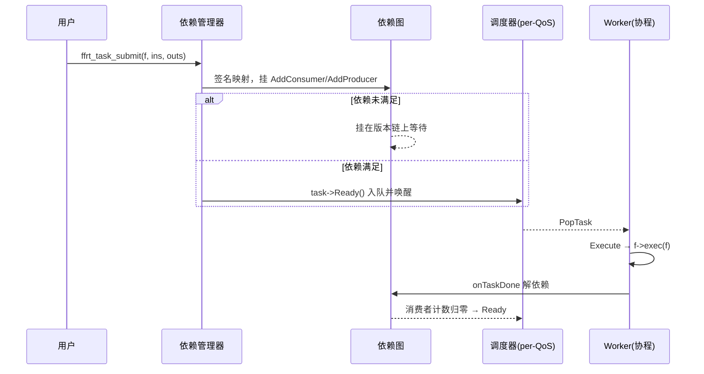
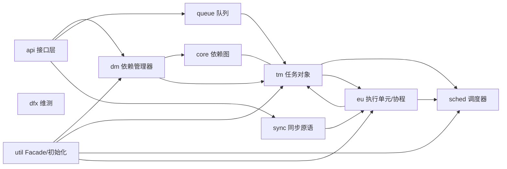

# FFRT 源码导读 · 骨架篇

> 本文是**骨架文档**：负责建立全景认知与阅读导航，每个主题只讲到"是什么、为什么、在哪条链路上"。
> 三件套配套剥离使用：**[FFRT实现细节.md](FFRT实现细节.md)**（细节篇，机制深挖）＋ **[FFRT参考手册.md](FFRT参考手册.md)**（参考篇，准确 API 与源码索引）。
> 两文均不依赖项目文件：`文件:行号` 仅作可选源码交叉参考，脱离源码可完整阅读。
> 梳理范围：FFRT 运行时（src / include / interfaces），日期 2026-10-04。

---

## 1. FFRT 是什么

FFRT（Function Flow Runtime）是 OpenHarmony 的**用户态并发编程框架**。它解决的核心问题：线程编程把"任务拆分"和"线程管理"耦合，导致线程滥用、负载不均、同步开销大。FFRT 的交换是——

- 开发者只提交**任务 + 数据依赖**，不创建线程；
- 运行时负责依赖解析、按 QoS 调度、协程化执行、线程池伸缩；
- 任务阻塞时**让出协程而不是挂起线程**，Worker 持续有活干。

一句话记住它：**你声明"谁依赖谁"，FFRT 决定"何时、在哪个线程、以什么优先级执行"**。

| 特性 | 含义 | 对应 API |
| --- | --- | --- |
| Task-Based | 以任务为编程与调度粒度 | `ffrt_task_submit` |
| Queue-Enabled | 用队列约束顺序 / 并发度 | 串行 / 并发队列 |
| Graph-Driven | 用任务依赖或数据依赖建图 | `ins/outs` 描述 |

注意：任务目标颗粒度最小约 **100us 量级**——太小调度开销吃掉收益，太大并行度上不去。

---

## 2. 五分钟看懂主链路

```text
ffrt_task_submit(f, ins, outs, attr)          ① 提交
  └─> 依赖管理器 onSubmit                       ② 建任务对象
        ├─ ins/outs 数据地址 → 依赖图节点        ③ 建数据依赖图
        │    ├─ 依赖未满足 → 挂在图上等待
        │    └─ 依赖已满足 ↓
        └─ task->Ready()                        ④ 就绪
              ├─ 按 QoS 入对应调度器运行队列       ⑤ 入队
              └─ 唤醒一个 Worker                 ⑥ 唤醒
Worker: PopTask → task->Execute()               ⑦ 执行（协程中跑 f->exec）
任务完成 → onTaskDone → 依赖图解阻塞             ⑧ 传递（消费者回到 ④）
wait/mutex/sleep → CoWait                       ⑨ 阻塞 = 协程让出
```

九步中，**③（依赖图）与 ⑨（协程让出）是 FFRT 区别于普通线程池的两条命脉**。



→ 每一步的机制细节见细节篇 §1（提交与建图）、§2（依赖图）、§3（任务对象）、§5（执行与协程）。

---

## 3. 核心概念

| 概念 | 一句话 | 延伸 |
| --- | --- | --- |
| 任务 Task | 运行时执行单元，对象内含闭包存储 | 细节篇 §3 |
| 数据依赖 | 任意 `void*` 地址作签名表达生产/消费关系 | 细节篇 §2 |
| 任务依赖 | 任务 handle 表达先后，只能作输入 | 细节篇 §1 |
| QoS | 优先级等级；队列/线程/锁全部按 QoS 隔离 | 细节篇 §4 |
| Worker | 干活的线程，由执行单元管理、可跨 QoS 共享 | 细节篇 §5 |
| 协程 | 用户态执行流；阻塞时 `CoWait` 让出 | 细节篇 §5 |
| Facade | 单例聚合门面，`Get*()` 快路径获取子系统 | 细节篇 §9 |

---

## 4. 总体架构

| 模块 | 职责 | 深挖入口 |
| --- | --- | --- |
| api | 对外 C/C++ 接口层 | 细节篇 §1 |
| core | 数据依赖图（Entity/VersionCtx） | 细节篇 §2 |
| dm | 依赖管理器：submit/wait/done 编排中枢 | 细节篇 §1 |
| tm | 任务对象族与工厂 | 细节篇 §3 |
| sched | per-QoS 调度器与运行队列 | 细节篇 §4 |
| eu | 执行单元：Worker 池、协程、poller、QoS/RTG | 细节篇 §5 |
| sync | 协程感知的 mutex/cv/sleep/timer | 细节篇 §6 |
| queue | 串行/并发队列 + 过载诊断 | 细节篇 §7 |
| dfx | 全链路打点、任务/Worker 周期监控、快照与崩溃黑盒 | 细节篇 §8 |
| util | Facade、初始化装配、slab、graph_check | 细节篇 §9 |



---

## 5. 任务生命周期骨架

九个阶段各一段话，机制细节全部指向细节篇：

| 阶段 | 发生什么 | 细节 |
| --- | --- | --- |
| ① 提交 | API 层把闭包和依赖描述交给依赖管理器 | §1 |
| ② 建对象 | 闭包与任务对象是同一块内存（placement new 前置技巧） | §3.2 |
| ③ 建图 | ins/outs 签名映射为版本节点，挂 producer/consumer | §2 |
| ④ 就绪 | 依赖计数归零（或无依赖）→ `Ready()` | §1.4 |
| ⑤ 入队 | 按任务 QoS 压入对应 `TaskScheduler` 运行队列 | §4 |
| ⑥ 唤醒 | `NotifyTask` 唤醒/新建该 QoS 的 Worker | §5.2 |
| ⑦ 执行 | Worker 主循环取任务，协程中运行用户函数 | §5.3 |
| ⑧ 传递 | `onTaskDone` 解依赖，下游消费者重新就绪 | §2.3 |
| ⑨ 阻塞 | wait/mutex/sleep 统一收敛为 `CoWait` 协程让出 | §5.4 / §6 |

等待语义只有两种：`ffrt_wait()` 等全部子任务（join），`ffrt_wait_deps()` 等指定数据。

---

## 6. 关键设计决策（速览）

| 设计 | 一句话理由 | 深挖 |
| --- | --- | --- |
| 闭包与任务同块内存 | 省分配、零跳转 | §3.2 |
| 地址当依赖签名 | 零成本表达数据流；正确性靠开发者自觉 | §2.4 |
| per-QoS 全隔离 | 优先级之间不抢锁、不抢队头 | §4.1 |
| 阻塞 = 协程让出 | 少量线程支撑海量并发任务 | §5.4 |
| done 后延迟解依赖（协程模式） | 防任务内存被复用后的 use-after-free | §3.4 |
| 接口 + 工厂注册 + Facade | 替换实现不动调用方 | §9 |
| TSAN 编译期关协程 | 协程切换会骗过 sanitizer | §10 |

---

## 7. 学习路径与自测

**路径**：

1. 用官方示例跑通 graph / queue 两种范式；
2. 沿第 2 章主链路通读源码（api → dm → tm → sched → eu）；
3. 啃硬骨头：数据依赖图 + 嵌套版本合并（细节篇 §2）；
4. 看协程让出/唤醒闭环（细节篇 §5.4）；
5. 横向扩展：sync / queue / 帧调度按需深入；**维测（细节篇 §8）建议必读**——协程框架的生产排障几乎全靠它；
6. 动手验证：改 QoS、加 timeout、用 dump 看队列。

**自测**（不看文档能答即主线已通）：

1. ins/outs 怎么变成图上的边？RAW / WAR 分别何时解除？
2. 任务在协程里 sleep 时，Worker 在干什么？
3. 为什么 handle 不能做输出依赖？
4. per-QoS 隔离了哪些东西？
5. 协程模式下任务 done 后为什么不立刻 onTaskDone？

→ 完整问答（实战排查 + 机制自测 + 工具使用 + 开放问题）见 **[FFRT问题集.md](FFRT问题集.md)**。

---

## 8. 术语表

| 术语 | 代码名 | 含义 |
| --- | --- | --- |
| 签名 | signature | 表达依赖的数据地址（void*） |
| 版本 | VersionCtx | 某数据地址的一次写入世代 |
| 就绪队列 | runqueue / RTQ | 调度器存放 Ready 任务的队列 |
| 让出 | CoWait | 协程暂停并交出 Worker |
| 根任务 | Root task | 裸线程提交任务时的虚拟父任务 |
| RTG | Real Time Group | 内核线程组，调度聚合 |
| 逃逸 | escape | 有任务却无运行中 Worker 时的紧急扩容与限频上报 |

→ 机制深挖请打开 **[FFRT实现细节.md](FFRT实现细节.md)** ｜ 查 API 与源码锚点请打开 **[FFRT参考手册.md](FFRT参考手册.md)**。
