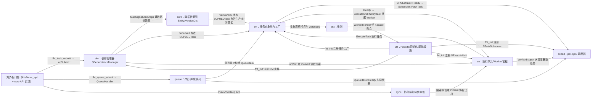

# 模块关系示意图：ffrt

> 由 `module-mapper/scripts/map_tools.py diagram` 生成，请勿手改；修改 [relationships.json](relationships.json) 后重新生成。

## 连线图例

| kind | mermaid 线型 | 含义 |
| --- | --- | --- |
| call | `-->` | 调用 / 组合 / 初始化 |
| config | `---` | 配置读取 |
| data | `---` | 数据共享 / 状态传递 |
| event | `-.->` | 事件 / 观察者回调 |
| ipc | `==>` | 跨进程接口（stub/proxy/binder） |
| kernel | `---` | 内核接口下发 |
| other | `---` | 其他 |

## 边表与证据

| 起点 | kind | 终点 | 说明 | 证据 |
| --- | --- | --- | --- | --- |
| api | call | dm | ffrt_task_submit → onSubmit | `src/core/task.cpp:76` |
| api | call | queue | ffrt_queue_submit → QueueHandler | `src/queue/queue_api.cpp:215` |
| api | call | sync | mutex/cv/sleep API | `src/sync/mutex.cpp:354` |
| dm | call | core | MapSignature2Deps 建数据依赖图 | `src/dm/sdependence_manager.cpp:137` |
| dm | call | tm | onSubmit 构造 SCPUEUTask | `src/dm/sdependence_manager.cpp:68` |
| dm | call | eu | onWait 走 CoWait 协程阻塞 | `src/dm/sdependence_manager.cpp:190` |
| core | data | tm | VersionCtx 持有 SCPUEUTask 作为生产者/消费者 | `src/core/version_ctx.h:38` |
| tm | call | sched | CPUEUTask::Ready → Scheduler::PushTask | `src/tm/cpu_task.cpp:54` |
| tm | call | eu | Ready → ExecuteUnit::NotifyTask 唤醒 Worker | `src/tm/cpu_task.cpp:57` |
| tm | call | dfx | 生命周期打点与 watchdog | `src/tm/cpu_task.cpp:52` |
| eu | call | sched | WorkerLooper 从调度器取任务 | `src/eu/cpu_worker.cpp:246` |
| eu | call | tm | ExecuteTask 执行任务 | `src/eu/cpu_worker.cpp:184` |
| sync | call | eu | 阻塞原语走 CoWait 协程让出 | `src/sync/sleep.cpp:51` |
| queue | call | tm | 队列提交构造 QueueTask | `src/queue/queue_api.cpp:42` |
| queue | call | sched | QueueTask::Ready 入调度器 | `src/tm/queue_task.cpp:86` |
| util | call | dm | ffrt_init 注册 DM 实现 | `src/util/init.cpp:70` |
| util | call | tm | ffrt_init 注册任务工厂 | `src/util/init.cpp:65` |
| util | call | sched | ffrt_init 注册 STaskScheduler | `src/util/init.cpp:66` |
| util | call | eu | ffrt_init 注册 SExecuteUnit | `src/util/init.cpp:71` |
| dfx | call | util | WorkerMonitor 经 Facade 聚合 | `src/util/ffrt_facade.h:45` |

> 节点间 `click` 跳转是否可用取决于阅读端；文档互链以各模块页的表格链接为准。